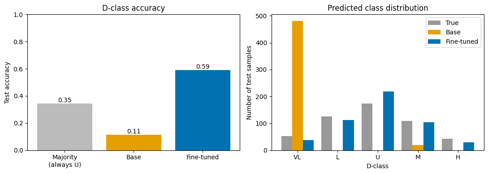
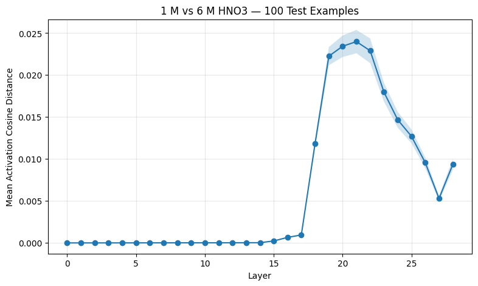
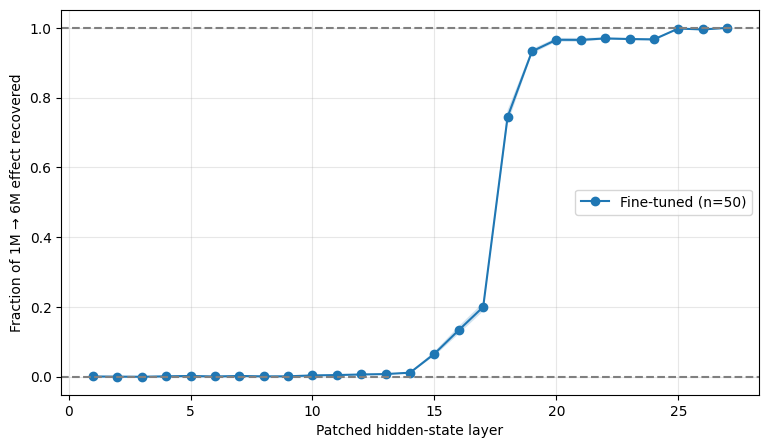

# Mechanistic Interpretability of a Fine-Tuned LLM for Solvent Extraction

Probing, activation patching, and sparse autoencoder (SAE) analysis of Qwen3-1.7B fine-tuned to predict distribution-coefficient classes for liquid–liquid extraction.

## Repository Structure
- `data/`: train/val/test JSONL
- `scripts/`: notebooks 01–04
- `figures/`: figures used in this README

## Data and model

Source: monoamide extraction data compiled by L. Augustine ([ACS Sustainable Chem. Eng. 2024, 12, 16692](https://dx.doi.org/10.1021/acssuschemeng.4c06166)), as reprocessed in the SeparationLLM repo [SeparationLLM](https://github.com/jschrier/SeparationLLM/tree/main).

*Example (one line of the chat-format JSONL):*

```json
{"messages": [
  {"role": "system", "content": "You are an expert liquid-liquid extraction chemist.\nUse the provided experiment description to predict the extraction selectivity.\nReturn only VL, L, U, M, H."},
  {"role": "user", "content": "1 M of CCCCC(CC)CN(CC(CC)CCCC)C(=O)C(C)C in n-dodecane is used to extract 800 mM U(VI) from an aqueous solution of 3 M HNO3 and 3 M nitrate at 20 C. The contact time is 20 min and the radiolytic dosage is 0 kGy."},
  {"role": "assistant", "content": "U"}
]}
```

- Task: classify the distribution coefficient D into 5 classes
- Split: train 1602 / val 400 / test 501

   | Class | Range | Share |
   | --- | --- | --- |
   | VL | D ≤ 0.01 | ~10% |
   | L | D ≤ 0.3 | ~25% |
   | U | 0.3 < D < 3 | ~35% |
   | M | D < 10 | ~22% |
   | H | D ≥ 10 | ~8% |

*Model weights (LoRA adapter, SAE checkpoint) are not included in this repository.*

## Notebooks

### 01-1-fine-tune-separationllm.ipynb
Qwen3-1.7B is a general-purpose model, not trained for this chemistry task, so we fine-tuned it.
- Used LoRA (r = 16, α = 32, attention projections q/k/v/o)
- Fine-tuned on the training set for 3 epochs (batch size 2 × 4 gradient-accumulation steps, learning rate 1e-4, loss on the answer tokens only)
- Validation loss was computed after each epoch, and the checkpoint with the lowest validation loss was kept

### 01-2-base-vs-ft-model.ipynb
Fine-tuning results:
- Test accuracy: 0.59 vs. base model: 0.11


### 02-layer-activation-analysis.ipynb
1. Extracted last-token activations at each layer of the fine-tuned model.
2. Probed each layer's activations to check what information the layer contains.
   - Probe: LogisticRegression (D-class, Metal), Ridge (R²) (HNO<sub>3</sub> conc, Molecular weight)
   - Used the validation set to train the probe and the test set to evaluate it
   - Targets: D-class, Metal identity, HNO3 concentration, Molecular weight

      | Probe | From Layer 1 | After Layer 17 |
      | --- | --- | --- |
      | D-class | ~0.5 | **ft ↑** (0.52 → 0.62) |
      | Metal Identity | ~1.0 | No big difference |
      | HNO<sub>3</sub> Conc | ~0.9 | ft ↓ |
      | Molecular weight | ~0.99 | **ft ↓↓** (0.93 → 0.8) |

3. Counterfactual analysis:
   - Changed the HNO<sub>3</sub> concentration to 1 M or 6 M to see if D increases as the concentration increases.
   - Cosine distance increased a lot between layers 17–23.
   
4. Patching:
   - The activation from the HNO<sub>3</sub> 6 M run was patched into the 1 M run.
   - Recovery was calculated with the D-class score.
     - The D-class score is the expected class index (VL=0, L=1, U=2, M=3, H=4), computed by taking a softmax over the five label-token logits at the last position.
     - Recovery = (D_patched − D_1M) / (D_6M − D_1M), i.e. how far the prediction moves from the 1M run toward the 6M run.
   - Recovery increased sharply around layers 18–19; before layer 18 it was at most 0.15.
   - This suggests that HNO<sub>3</sub> information reaches the last token around layers 18–19.
   

### 03-sae-layer19.ipynb
1. Trained a Top-K SAE (K = 64) on layer 19.
2. Used the train + val sets (2002) for training the SAE.
3. Picked features related to high D and low D based on the validation set; these showed similar correlations with the D-class score on the test set.

   | Feature | Direction | val corr | test corr |
   | --- | --- | --- | --- |
   | 1208 | High-D | +0.568 | +0.576 |
   | 380 | High-D | +0.522 | +0.543 |
   | 1205 | High-D | +0.521 | +0.524 |
   | 827 | Low-D | -0.538 | -0.541 |
   | 1615 | Low-D | -0.522 | -0.536 |
   | 245 | Low-D | -0.508 | -0.527 |

4. For metal identity, the correlation data didn't show anything clear.
5. Picked one High-D and one Low-D feature (1208 and 245) to see if they carry only concentration information.
   - Both were still correlated with the D-class score at fixed HNO<sub>3</sub> concentration, which suggests that these features carry information beyond HNO<sub>3</sub> concentration.

### 04-sae-feature-intervention.ipynb
1. Base vs. ft SAE:
   - Features 1208 and 245 were activated only in the ft model, which suggests that these features emerged through fine-tuning.
2. Changed the values of features 1208 and 245.
   - A higher 1208 value increased the D-class score.
   - Changing 245 didn't make much difference.
3. Patched 6 M feature values into the 1 M run (same recovery metric as 02).
   - One sample (D-class score 1.18 at 1 M, 3.62 at 6 M): top-20 feature patching gave 81% recovery.
   - More samples (401), median recovery:
     - Top-20 most-changed features → 76%
     - 20 randomly picked features → 15%
     - 20 features selected in 03 (High-D + Low-D) → 39%

      | Features patched (6M → 1M) | Recovery |
      | --- | --- |
      | Top 1 most-changed | 13% |
      | Top 5 | 40% |
      | Top 10 | 60% |
      | Top 20 | 76% |
      | Top 50 | 89% |
      | 20 random features | 15% |
      | 20 features selected in 03 | 39% |


## Summary
- Fine-tuning Qwen3-1.7B with LoRA raised test accuracy from 0.11 to 0.59.
- HNO<sub>3</sub> information reaches the last token around layers 18–19 and is carried forward from there.
- In the layer-19 SAE, about 20 features carry roughly 3/4 of the HNO<sub>3</sub> effect, and key features (1208, 245) appear only in the fine-tuned model.
- Features selected by correlation with D only partly overlap with the features the model actually uses for the HNO<sub>3</sub> effect (39% vs. 76% recovery).
